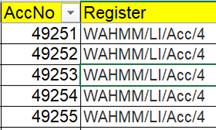

# Importing Library batches for WA/HMM/LI/Acc/3 to /12

### Step 1. Prepare the batch for checking

1. The file will be saved under the location Documents > General > Checked Pre-Import in the Transcribers' Teams group.
2. Select the file and download it to _your_ local OneDrive. This is the file you will be working with to check - not the copy in the Teams folder.

### Step 2. Double check the returned spreadsheet

1. Unhide any hidden columns. If present, delete column containing ‘**`Volume URL`**’ whether it is empty OR if it has links in it.
2. Check if there are any empty rows (such as blank slips) and delete them.
3. Select the **`Date of Accession`** field and right click to ‘Format cells’ according to 'Date' and then the long format: DD Month YYYY.
4. Check consistency of **`Date of Accession`** field. Ensure that a date has been entered in every row and that normalisation rules have been applied to the last day of the month where necessary.
5. Check **`Register`** field is correctly entered and includes a slash for WAHMM, e.g. WA/HMM. Check that the register has no blank entries and a correct reference throughout.\
    à .png>)
6. Use the filter function to check that **`Image no.`** field has no empty entries. If relevant, check it matches correct **`rh image number`** if applicable.
7. Ensure the **`Author`** column has been correctly formatted, e.g. Surname, Forenames (Title)
8. Check Value/Price/Cost field is entered correctly. Check that multiple items in the **`Price/Cost`** column have been noted with square brackets and a note in the **`Transcribers Notes`.**
9. Filter out all blank cells in **`Additional notes found on flimsy /Remarks`**, making sure they are additional notes _from the flimsy/register_, and if not, transfer to **`Transcriber’s Notes`** column.
10. Check multiple numbers in the Lot No. field. Check Sales Catalogues where possible, and make a note of unable to determine which item is which.
11. Make sure the **`Transcriber’s name/Transcribed by`** field is standardised correctly with the transcriber’s e-mail address and _not_ the name.
12. Filter out all the blank cells in **`Transcriber’s Notes`** and check each comment, particularly any 'unsure' notes. Correct where possible.
    * If the transcriber has indicated uncertainty about transcription, check the digitised image and make corrections where you can.
    * Add note to **`Transcriber’s notes`** if date has been normalised, e.g. ‘Accession date normalised to last day of entry.’
13. Check Sensitivity field – this should just have ‘Y’ in the box. Move any other details to Transcriber’s Notes field
14. Use spell check across the spreadsheet for any obvious spelling errors. Through CTRL +F, search for any fields containing ‘ditto’ and update with the relevant details, where necessary.
15. Check and correct vulgar fractions (1/2, 1/4, 3/4 are fine, all others need to be replaced, this includes fractions that have been spelled out and need to be re-typed as numbers).
16. Search for question marks (\~?) for any words that transcribers were unsure of. Add to **`Transcribers Notes`** for transcribed question marks.
17. Double check for any non-Latin script and ensure this is transliterated / marked in **`Transcriber's Notes`**.
18. Check and correct any missing tagging on scored-through text through CTRL+F.

19\.   Check stamps are written as \[stamp].

20\.   Check the bottom few rows of the sheet, in case additional rows have been added for out-of-place accession numbers. If so, add any missing WA/HMM Box references for these rows, and highlight the rows in a different colour so that they stand out at the next stage.

21. Make sure the assigned batch is transcribed and nothing less or more. If there is a discrepancy, make a note and follow up.
22. \[If passing onto another member of the team for Steps 3 and 4] Move the spreadsheet into 'Checked Pre-import' folder on the Transcribers’ Teams channel

### Step 3. Prepare Excel data for import to Quickbase

1. Open the transcription spreadsheet in Excel. Unhide any hidden columns and delete them if they are blank to avoid confusion during the import stage.
2. Each accession record needs to be matched to a record ID on Transcribe Wellcome. Insert a new column for `RID#` (i.e. TW record record ID number) to the left of `Date of Accession`.
3. Open (or download from TW) the relevant RID#.csv file for the register you are checking. Previously downloaded RID# files can be found in a folder in the Transcribers' Group sharepoint Documents > General > Completed spreadsheets > RID#s.
4. Create a new tab on the transcribed spreadsheet, and copy and paste the contents as values into it.
5. Close the RID#.csv file.
6. Add the RID#s to each cell in the RID# column in the transcription spreadsheet, by copying the formula `=IFERROR(VLOOKUP(C2,Sheet1!A:B,2,FALSE),"")` into cell A2 and filling down the column (at the corner of the cell, double click - or drag down - the '+' button and it'll drop down all the details).
7. Delete any additional data in blank rows at the end of the transcribed spreadsheet, and spot check a couple of entries on the 'RID#' tab to be sure the data matches.
8. Before uploading, the RID# column needs to formula to be removed. To do this, highlight the column (usually column A), copy the RID# column and paste as 'Values (V)'. Add a filter to this column to check there are no blank cells.

### Step 4. Import spreadsheet to Transcribe Wellcome

1. Carry out a few spot checks on steps 2 and 3 above e.g. date format, accuracy of transcription.
2.  Sign into TW as admin. From the home page,&#x20;

    * select the ‘More’ tab (right hand end of top bar) and select ‘Import/Export’.

    .png>)

    * For Choose Action, select 'Import into a table from a file'.
    * For Select Table, select ‘Library Accessions’.
    * For Select Merge Field, retain the default selection (‘Record ID#’).
    * For Choose File, select the prepared transcription spreadsheet.
    * Select 'Import From File'.\
      .png>)
3. Check that the alignment of columns in the Quickbase table match the columns in the prepared spreadsheet. The TW database is not very good at guessing which field heading is correct, so be careful you are selecting the correct field. There's no need to import the CC0 licence in each row of the data:

<table><thead><tr><th valign="top">Transcription Spreadsheet Column Headings</th><th valign="top">Transcribe Wellcome fields</th></tr></thead><tbody><tr><td valign="top">RID#</td><td valign="top">Record ID#</td></tr><tr><td valign="top">Date of Accession</td><td valign="top">Date of Accession</td></tr><tr><td valign="top">Accession number</td><td valign="top">Accession number</td></tr><tr><td valign="top">Register</td><td valign="top">Register</td></tr><tr><td valign="top">Page image no.</td><td valign="top">Page image no.</td></tr><tr><td valign="top">rh page image no. (if applicable)</td><td valign="top">rh page image no. (if applicable)</td></tr><tr><td valign="top">Location Number</td><td valign="top">Location Number</td></tr><tr><td valign="top">Author</td><td valign="top">Author</td></tr><tr><td valign="top">Title/Description</td><td valign="top">Title/Description</td></tr><tr><td valign="top">No. of vols (V or P)</td><td valign="top">No. of vols (V or P)</td></tr><tr><td valign="top">No. of vols (Manuscript)</td><td valign="top">No. of vols (Manuscript)</td></tr><tr><td valign="top">Size</td><td valign="top">Size</td></tr><tr><td valign="top">Place of Publication</td><td valign="top">Place of Publication</td></tr><tr><td valign="top">Date of Publication</td><td valign="top">Date of Publication (imprint)</td></tr><tr><td valign="top">Printer</td><td valign="top">Printer</td></tr><tr><td valign="top">Price</td><td valign="top">Price</td></tr><tr><td valign="top">Valuation</td><td valign="top">Valuation</td></tr><tr><td valign="top">Donor or Vendor (Source)</td><td valign="top">Donor or Vendor (Source)</td></tr><tr><td valign="top">Lot Number</td><td valign="top">Lot Number</td></tr><tr><td valign="top">Condition</td><td valign="top">Condition</td></tr><tr><td valign="top">Remarks</td><td valign="top">Remarks</td></tr><tr><td valign="top">Transcribed by</td><td valign="top">Transcribed by</td></tr><tr><td valign="top">Transcribers Notes</td><td valign="top">Transcribers Notes</td></tr><tr><td valign="top">Creative Commons</td><td valign="top">Record owner [DO NOT IMPORT]</td></tr></tbody></table>

4. Select 'OK' to the warning message about updating existing records.
5. Select ‘Do not import’ for CCO.
6. Select 'Import (with updates)'.
7. Once imported, select 'Go to the application's dashboard'.
8. Select ‘Library Accessions’ > ‘Reports & Charts’ > ‘Common – List changes.’ This shows the most recent imports.
9. Check the spreadsheet has been imported correctly. Check that the links match with the correct digitised records/pages in ‘Register Page URL’. Other items to look out for include: date of accession, fractions, £ signs, diacritics.
10. Check accessions by quarter report for outliers. Click on ‘Library Accessions’ > ‘Reports & Charts’ > ‘WHML data analysis – Library accessions by quarter’. Check the bar chart dates to make sure they look accurate
11. Save the imported transcription spreadsheet in the relevant 'imported to QB' folders in both Sharepoint locations, and mark the import off as complete on the transcribers' log.

[ ](https://docs.wellcomecollection.org/collections-information/lQ0fMyP8xr8hWWJiQkfl/transcribe-wellcome/project-management/importing-itemisation-batches)
